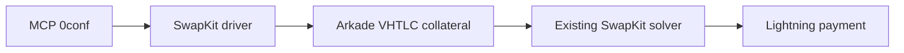

# Public 0conf MCP/API

Small `node:http` wrapper around the existing outgoing SwapKit driver: one BOLT11 payment from the existing Nuri card Arkade wallet, using preconfirmed Arkade VHTLC collateral and the existing SwapKit solver corridor. It adds no node, CLN, regtest, arkd, swap protocol, framework, or dependency.

## Status and evidence

- **CLI mainnet proof:** order `ord_d073e885c6d9b72483388085abffb227b29e970f8143ab1feed0840b44a56076`, Ark funding transaction `7d762a0ac6e8f537df44f48708d34bc66b41970803e2e6d706ef962cf2af3fd1`, **1000 sats settled**. The recipient preimage's SHA256 matched the invoice payment hash.
- **MCP mainnet proof:** order `ord_8fe501e631efc7bee3495a9500012c98a03c90593887fc85ec8c59db50d3ed47`, Ark funding transaction `9066c5781324d0af5d60e58ef5bc3a291d804b344843536637a7d11fced4e7e0`, final status `COMPLETED`, **1000 sats settled**. The recipient preimage's SHA256 matched the invoice payment hash.
- Machine-readable receipts: [`proofs/mainnet-outgoing.json`](proofs/mainnet-outgoing.json). No production deployment or reverse-flow proof is claimed.
- The card follow-up cosign fixes are retained: each signature request carries its own PSBT, and checkpoint signatures are preserved when inputs are updated.

## Start

Requires Node `>=22.13.0 <27` and the existing local card configuration. Copy `config/card-mainnet.example.json` to `.run/card.json` and fill it locally. Keep it and the journal outside git; card credentials are never accepted in MCP arguments or intentionally returned in responses.

```bash
npm ci
CARD_CONFIG="$PWD/.run/card.json" JOURNAL_PATH="$PWD/.run/0conf.journal.json" HOST=0.0.0.0 PORT=3000 npm start
```

The exact server command is the last line above. Default host is `127.0.0.1`; `HOST=0.0.0.0` exposes the unauthenticated API to the network, so use it only on an intended trusted interface. `GET /healthz` returns `{ "ok": true, "git_sha": "..." }` from `git rev-parse HEAD`, or the explicit `GIT_SHA` override.

## MCP surface

`POST /mcp` supports JSON-RPC `initialize`, `tools/list`, and `tools/call`. The catalog contains exactly one tool, **`0conf`**, with actions:

| Action | Default behavior | `execute: true` |
| --- | --- | --- |
| `quote` | Read-only route quote and local quote journal | No additional money action |
| `create` | Dry run; no order commit | Creates/binds the SwapKit order |
| `finalize` | Dry run; no intent, card signature, or funding | Performs/resumes funding and evidence submission |
| `track` | Read-only provider status/evidence refresh | No additional money action |

All calls require `invoice` and exact `amountSats`; `finalize` and `track` also require the full `orderId`. Use the same journal for every retry. The existing CLI and its explicit `--execute` gate remain available in [`docs/PARENT_COMMANDS.md`](docs/PARENT_COMMANDS.md).

Dry MCP example:

```bash
curl -sS http://127.0.0.1:3000/mcp \
  -H 'content-type: application/json' \
  --data '{"jsonrpc":"2.0","id":1,"method":"tools/call","params":{"name":"0conf","arguments":{"action":"create","invoice":"lnbc...","amountSats":1000}}}'
```

Successful calls return both MCP text content and `structuredContent`. Receipts follow [`schema/receipt.schema.json`](schema/receipt.schema.json) and always carry `orderId`, `fundingOutpoint`, and `finalStatus` (nullable before the corresponding stage). `preimage` is non-null only when its SHA256 matches the invoice payment hash. Provider `COMPLETED`, `FILLED`, and `SETTLED` states, including a settled `rawProviderState`, map to final status `COMPLETED`; unknown non-final states remain visible rather than failing.



## Verify

```bash
npm test
```

The suite uses synthetic provider/wallet fixtures and an ephemeral loopback HTTP server. It covers the one-tool catalog, dry/execute gating, settled-state mapping, per-PSBT cosign binding, replay/crash handling, and credential leakage. Fixtures are not mainnet proof.

The full dependency-backed `npm test` passed **19/19** on Node `v22.22.3`. Earlier cloud checks also passed the MCP suite; the cloud runner was unavailable for the final full-suite run, which used the already-authorized local card session without live wallet calls.

## Remaining work and limits

- **Reverse flow (Lightning → Arkade):** implement the reverse SwapKit quote/order binding, issue and bind an incoming Lightning invoice/preimage, define the opposite VHTLC collateral and claim/refund paths, reconcile inbound payment before releasing Arkade funds, add restart/replay and failure fixtures, then run a separate mainnet proof. None of that is exposed by this outgoing-only tool.
- Outgoing solver refunds are tracked as `REFUND_READY`/`REFUND_PENDING`; refund signing/broadcast is not implemented.
- After restart, an in-memory Nuri approval session cannot be reconstructed. Existing funding evidence remains resubmittable, but `send/complete` can be `UNAVAILABLE_AFTER_RESTART`.
- No production deployment is claimed. Outgoing CLI and MCP mainnet payments are proven; reverse flow and refund execution remain unproven.

## Raw L1 0-conf collateral fronting

`src/l1-collateral.js` locks user sats in the existing Nuri MuSig2+CSV taproot
address on L1; `src/l1-front.js` turns a *seen, unconfirmed* deposit into one
Lightning payment through the proven `CardLightningDriver`. The Arkade VHTLC
path above is untouched.

```bash
npm run l1:create -- --client-pk <33-byte-hex> --ref order-1 --sats 25000 --invoice lnbc...
npm run l1:check  -- --order l1c_... --txid <hex> --vout 0
npm run l1:front  -- --order l1c_... --txid <hex> --vout 0 --invoice lnbc... --amount-sats 25000
npm run l1:show   -- --order l1c_...
```

Fronting preconditions, all checked before the driver is touched:

1. `validateDeposit` accepts script, exact value, and outpoint; a reused
   outpoint on another order is refused.
2. `receipt.eligible_0conf === true` — the funding tx is unconfirmed and every
   input sequence is BIP125 non-signaling. Confirmed deposits do **not** front.
3. Deposit value, order `amount_sats`, and invoice amount are identical, and the
   invoice payment hash equals the one bound at order creation.
4. `now < lightning_due_at` and `now < expires_at`.
5. The supplied invoice is the one in the terms digest.

Ordering is the exactly-once mechanism: a durable claim is written before the
driver call, and the provider `orderId`, `fundingOutpoint`, and `finalStatus`
are persisted into the receipt and journal columns afterwards. A replay of a
paid order returns the stored receipt; a replay after a crash (claim, no result)
returns `fronting: "unknown"` and does not pay again. The driver journal keeps
its own second `wallet.send` guard, so both layers agree.

Caps stay 5 000..100 000 sats. **Remaining, not implemented here:** claiming the
L1 collateral after the payment settles (MuSig2 aggregate spend or the user's
CSV leaf), mempool eviction/disappearance handling, expired-order refunds, MCP
exposure, and a live mainnet proof.
